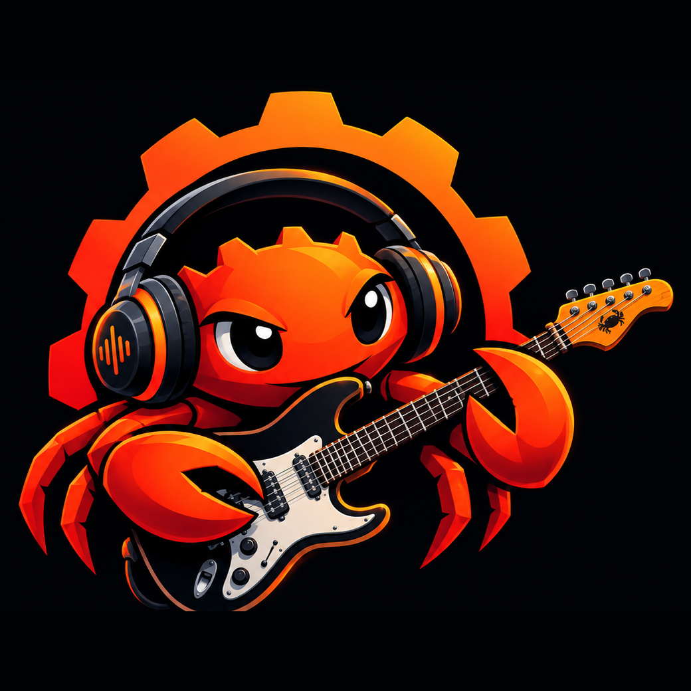

<p align="center">
  
</p>

<h1 align="center">Manguebyte</h1>

<p align="center">
  <strong>A modern, real-time-safe audio framework for Rust.</strong><br>
  Our goal is to be for Rust what JUCE is for C++, and then go further.
</p>

<p align="center">
  <a href="https://github.com/alessonqueirozdev-hub/manguebyte/actions/workflows/ci.yml"></a>
  
  
</p>

---

## The goal

C++ has [JUCE](https://juce.com): one framework that takes you from an empty
folder to a shipping synthesizer, effect plugin or audio application on every
major platform. Rust has excellent audio crates, but they are scattered pieces
that each project has to glue together on its own.

**Manguebyte intends to be the complete equivalent of JUCE for Rust**: audio
and MIDI device I/O, DSP, audio file formats, a parameter system, plugin
formats (CLAP, VST3, AU, LV2, standalone), plugin hosting, and a GUI toolkit,
all designed to work together and all under a permissive license.

We do not want a port. We want what a framework looks like when it is designed
for Rust from the first line:

- **Fearless real-time code.** Ownership rules catch data races between the
  audio thread and the UI at compile time, instead of as a crackle in
  production.
- **Zero-cost composition.** A tuple of processors is a processor. The chain is
  resolved at compile time, with no virtual calls and no allocation.
- **Small, independent crates.** Use the whole framework or only the buffer
  type. `manguebyte-core` has no dependencies at all.
- **Permissive licensing.** MIT or Apache-2.0, your choice. No copyleft, no
  per-seat fees, no splash screen.

## Status

Manguebyte is **young**. Version 0.1 is the foundation: it is tested and
usable, but it covers a small part of the road ahead, and the API will change
before 1.0. See [ROADMAP.md](ROADMAP.md) for what exists and what is planned.

| Crate | What it gives you today |
|---|---|
| [`manguebyte`](crates/manguebyte) | The whole framework under one name, plus a prelude |
| [`manguebyte-core`](crates/manguebyte-core) | `AudioBuffer`, the `Sample` trait, `Smoothed` values, atomic floats, a wait-free SPSC queue, decibel maths |
| [`manguebyte-dsp`](crates/manguebyte-dsp) | The `Processor` trait and tuple chains, band-limited oscillator, biquad filters (8 shapes), ADSR envelope, delay line and echo, smoothed gain |
| [`manguebyte-midi`](crates/manguebyte-midi) | MIDI message parsing and encoding, sample-accurate `MidiBuffer`, pitch conversions |
| [`manguebyte-formats`](crates/manguebyte-formats) | WAV reading (8/16/24/32-bit PCM, 32/64-bit float) and writing (16/24-bit PCM, 32-bit float) |
| [`manguebyte-devices`](crates/manguebyte-devices) | Playback on the default output device, in any hardware sample format |

Not there yet: audio input, device selection, MIDI device I/O, compressed
formats, FFT, parameters, plugin formats, plugin hosting and GUI.

## Quick start

Manguebyte is not on crates.io yet. Depend on it straight from Git:

```toml
[dependencies]
manguebyte = { git = "https://github.com/alessonqueirozdev-hub/manguebyte" }
```

Build a synth voice by putting processors in a tuple, then render it to a WAV
file:

```rust,no_run
use manguebyte::prelude::*;

fn main() -> Result<(), wav::WavError> {
    let spec = ProcessSpec { sample_rate: 48_000.0, max_block_size: 48_000, num_channels: 2 };

    // A tuple of processors is itself a processor.
    let mut voice = (
        Oscillator::new(Waveform::Saw, note_to_hz(45.0)),
        Filter::new(FilterShape::Lowpass, 1_200.0, 1.5),
        Gain::from_db(-12.0),
    );
    voice.prepare(&spec);

    let mut second = AudioBuffer::<f32>::new(2, 48_000);
    voice.process(&mut second);

    wav::write_file("saw.wav", &second, 48_000, WavFormat::Int16)
}
```

Play it live instead:

```rust,no_run
use manguebyte::prelude::*;

fn main() -> Result<(), DeviceError> {
    let device = OutputDevice::open_default()?;
    let spec = ProcessSpec {
        sample_rate: device.sample_rate(),
        max_block_size: 512,
        num_channels: device.num_channels(),
    };

    let mut voice = (Oscillator::new(Waveform::Sine, 440.0), Gain::<f32>::from_db(-18.0));
    voice.prepare(&spec);

    // The closure runs on the audio thread.
    let _stream = device.start(512, move |buffer| voice.process(buffer))?;
    std::thread::sleep(std::time::Duration::from_secs(2));
    Ok(())
}
```

## Examples

```bash
# Render a short synth riff to a WAV file. Needs no audio hardware.
cargo run --example render_wav -- riff.wav

# Play the same riff on your speakers. The optional argument is a level in dB.
cargo run --example play_riff -- -12
```

On Linux the device backend needs the ALSA development headers
(`sudo apt install libasound2-dev` on Debian and Ubuntu).

## Why "Manguebyte"?

The name comes from Recife, the city in the north-east of Brazil where this
project was born.

Recife is built on mangroves, *mangue* in Portuguese: tidal forests where
rivers meet the sea, and one of the most fertile ecosystems on Earth. In the
early 1990s the city was in deep economic trouble, and a group of local
musicians answered with a manifesto called *Caranguejos com Cérebro*,
"Crabs with Brains". Its proposal was to plug the rich, muddy roots of the
region's culture into the global network of ideas. The image they chose was
a satellite dish stuck in the mangrove mud.

The movement was called **mangue bit**: *mangue* for the mangrove, *bit* for
the unit of digital information. The press heard "beat", and the world came to
know it as **manguebeat**. Bands such as Chico Science & Nação Zumbi and Mundo
Livre S/A mixed maracatu, coco and ciranda with rock, funk, hip-hop and
electronic music, and changed Brazilian music for good.

This project borrows that idea, and the name fits in more ways than one:

- **Mangue** is where we come from, and it is the home of the crab, which is
  both the symbol of the movement and, as it happens, the mascot of Rust.
- **Byte** is the bit grown up: eight of them, the unit that software is
  actually written in. It is our nod to *mangue bit*, one step further on.
- It is a **music** name for a music framework, taken from a movement that
  was about connecting local roots to global technology. That is what open
  source does.

So the logo is a crab with headphones and a guitar: a crab with brains, making
noise.

## Contributing

Manguebyte is built in the open and contributions are welcome, from typo
fixes to whole new crates. Read [CONTRIBUTING.md](CONTRIBUTING.md) to get
started, and [ROADMAP.md](ROADMAP.md) to see where help is most needed.

One rule matters above the others: **Manguebyte is a clean-room project.** It
is inspired by what JUCE makes possible, but it contains no JUCE code and must
never contain any. Please do not copy or translate source code from JUCE or
from any other project whose license is not compatible with ours.

## License

Licensed under either of

- Apache License, Version 2.0 ([LICENSE-APACHE](LICENSE-APACHE))
- MIT license ([LICENSE-MIT](LICENSE-MIT))

at your option.

Unless you explicitly state otherwise, any contribution intentionally
submitted for inclusion in this project by you, as defined in the Apache-2.0
license, shall be dual licensed as above, without any additional terms or
conditions.

## Disclaimer

Manguebyte is an independent project. It is not affiliated with, sponsored by
or endorsed by the makers of JUCE. JUCE is a trademark of its respective owner
and is mentioned here only to describe the kind of framework this project
aims to be.
